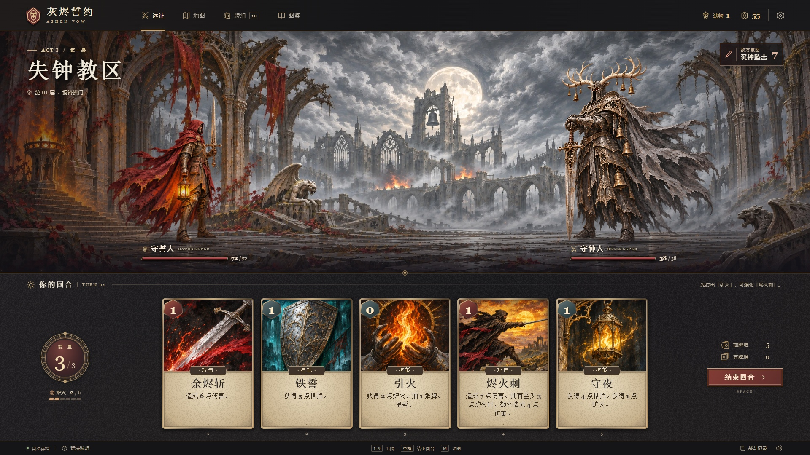

# 灰烬誓约 · ASHEN VOW

提灯穿过失钟教区、烬海修院和蚀日圣座。一局远征共有 24 层，玩家通过预读敌方意图、调配能量、积攒炉火来构筑牌组。Windows x64 本地发行候选版为 v0.9.0，界面及玩法文字均为简体中文。

## 开始游戏

从 [v0.9.0 发行页](https://github.com/NonoKing123456/ashen-vow-deckbuilder/releases/tag/v0.9.0) 下载 `AshenVow-0.9.0-Windows-x64.zip`，完整解压后双击 `AshenVow.exe`。同一发行页也提供 Steam 商店素材包。



在 `release/AshenVow-Windows-x64/` 双击 `AshenVow.exe`。发行 ZIP 需要完整解压。桌面版自带运行环境，支持离线游玩。也可直接打开根目录的 `index.html` 游玩浏览器版本，两种运行方式各自保存进度。

首次进入会遇到守钟人。点击手牌、按数字键或将牌向上拖至战场即可出牌，右键可查看卡牌及升级效果。先用零费「引火」，再打「烬火刺」，可以利用炉火条件提高伤害。按空格结束回合，按 M 看路线，按 Esc 打开设置。点击左上方灯徽可返回主菜单。

每幕第八层都有一位拥有第二阶段的幕主。远征中可以获得 44 种可升级卡牌和 12 件遗物，遭遇 15 种敌人与 11 种奇遇。通关可逐级解锁 10 个誓阶。重游种子 `ASHEN-PILGRIM-01` 可进入商店实机截图所用的路线。

## 存档与控制

桌面版在 `%APPDATA%\AshenVow\saves\` 原子写入 JSON 远征存档、上一检查点和跨局记录。备份时可一并复制该目录下的三个 JSON 文件。浏览器版使用当前浏览器的本地存储。设置里可单独调整音乐与音效、静音、减少动态效果和切换全屏。

支持标准映射手柄。方向键或左摇杆导航，A 确认，B 返回，X 结束回合，Y 看地图，LB/RB 逐项切换，LT 检视，右摇杆滚动。已验证模拟输入、断线重连与输入设备切换。

## 开发与构建

Windows x64，Node.js 22.12 或更高版本。在项目根目录执行下列命令。

```powershell
npm.cmd ci
npm.cmd start
npm.cmd test
npm.cmd run package
```

首次运行开发版会获取 Electron。打包产物包含运行环境、游戏内容及 Chromium 第三方许可。打包命令会更新 release 目录下的可运行文件夹及 ZIP。

战斗规则位于 `game/engine.js`，远征、地图生成及存档位于 `game/campaign.js`。界面由 `game/app.js`、`game/ui.js` 和 `game/expedition-ui.js` 构建。三幕战场、角色精灵、叙事插画和卡面位于 `assets/`，配乐与音效由 `game/audio.js` 在本机实时合成。

## 验证

```powershell
npm.cmd test
node tests/journey-smoke.cjs
node tests/controller-smoke.cjs
node tests/desktop-smoke.cjs
node tests/desktop-smoke.cjs "release/AshenVow-Windows-x64/AshenVow.exe"
```

自动测试覆盖 88 个基础与升级牌面、费用和行动顺序、种子路线、交易、存档恢复和通关解锁。整局 UI 测试使用已安装的 Edge，以正常游戏按钮完成 24 层远征。桌面测试使用独立临时存档目录，退出并重启后比对整份存档。已测试的桌面系统为 Windows 11 Pro x64。真机手柄与 Steam Deck 仍需实测。

## Steam 发行资料

`steam/` 包含预告片、九张 1920×1080 实机截图、八张商店和游戏库图像、中文商店文案，以及生成式 AI 内容调查草案。SteamPipe 配置模板位于 `steam/steampipe/`。实际提交前需要使用发行方账号取得 App ID 和 Windows Depot ID，将两项占位符换为后台分配的值，启动项使用 `AshenVow.exe`。可将 Steam Auto-Cloud 规则指向 WinAppDataRoaming 下的 `AshenVow/saves` 与 `*.json`。

本地交付已完成。Steam 后台配置、定价、商店与构建审核、公开发布日期由发行方确认。实体设备兼容性和外部玩家对平衡及可读性的反馈仍待验证。
